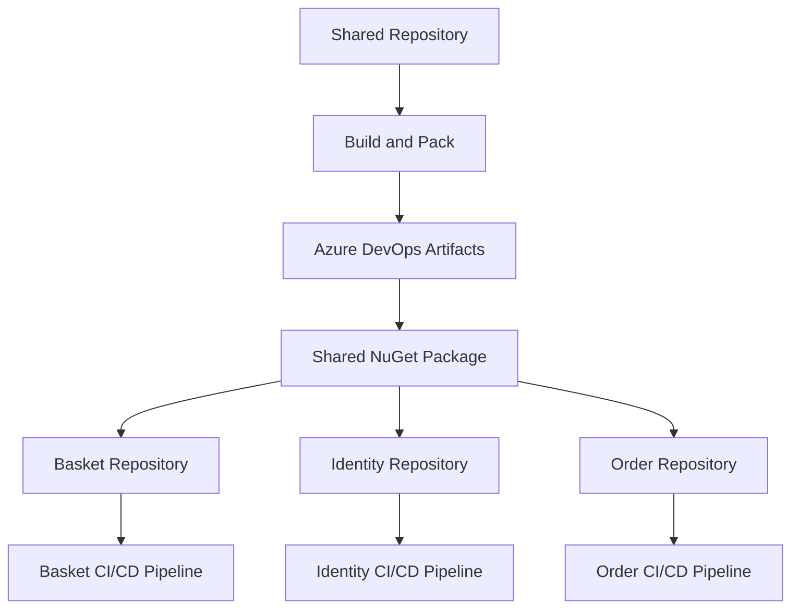

# Multi-Repository .NET Architecture

A practical .NET 10 Multi-Repository architecture demonstrating reusable NuGet packages, independent application repositories, and CI/CD automation using Azure DevOps.

---

## Overview

This project demonstrates how to design, develop, build, and maintain multiple independent .NET applications using a Multi-Repository architecture.

Instead of maintaining all applications in a single repository, each application has its own Git repository, solution, project structure, and development lifecycle.

A shared .NET class library is developed separately, packaged as a NuGet package, and distributed through Azure DevOps Artifacts.

The main objectives are code reusability, independent development, centralized package management, and automated CI/CD workflows.

## Architecture

The project consists of four independent repositories:

| Repository | Description | Type |
|---|---|---|
| [Shared](https://github.com/simaparini-git/Shared) | Reusable .NET Class Library | Class Library |
| [Basket](https://github.com/simaparini-git/Basket) | Basket application | ASP.NET Core Web API |
| [Identity](https://github.com/simaparini-git/Identity) | Identity application | ASP.NET Core Web API |
| [Order](https://github.com/simaparini-git/Order) | Order application | ASP.NET Core Web API |

Each repository maintains its own source code, solution file, Git history, and CI/CD pipeline.

## System Architecture



## Repository Structure

The overall architecture follows this structure:

```text
MultiRepo-Architecture/
│
├── Shared/
│   ├── Shared.slnx
│   ├── src/
│   │   ├── Shared/
│   │   └── Shared.Tests/
│   ├── NuGet.Config
│   └── README.md
│
├── Basket/
│   ├── basket.slnx
│   ├── src/
│   │   └── Basket/
│   └── README.md
│
├── Identity/
│   ├── Identity.slnx
│   ├── src/
│   │   └── Identity/
│   └── README.md
│
└── Order/
    ├── Order.slnx
    ├── src/
    │   └── Order/
    └── README.md
```

Each folder represents an independent Git repository, not a subdirectory of a single Git repository.

## Technologies Used

- C#
- .NET 10
- ASP.NET Core Web API
- .NET Class Libraries
- MSTest
- NuGet Package Management
- Azure DevOps Server (On-Premises)
- Azure DevOps Artifacts
- Azure DevOps Classic Build Pipelines
- Git
- GitHub

## Shared NuGet Package Management

The Shared repository contains reusable components that can be consumed by independent applications.

The package lifecycle is:

1. Develop reusable components in Shared.
2. Build and test the Shared solution.
3. Pack the library into a NuGet package.
4. Publish the package to Azure DevOps Artifacts.
5. Configure consuming repositories to use the Shared-Feed.
6. Restore and install the required package version in each application.

Example package reference:

```xml
<PackageReference Include="Shared" Version="1.0.0" />
```

Azure DevOps Artifacts Feed:

`Shared-Feed`

This approach allows applications to consume versioned dependencies without directly referencing another repository's source code.

## CI/CD Pipeline Architecture

Azure DevOps Classic Pipelines are used to automate the build and delivery processes.

### Shared Pipeline

The Shared pipeline includes:

1. NuGet Restore
2. Build
3. Test
4. Pack
5. Push NuGet Package to Azure Artifacts
6. Publish Build Artifact

### Application Pipelines

The Basket, Identity, and Order pipelines include:

1. NuGet Restore
2. Build
3. Test
4. Publish Build Artifact

The application pipelines restore the Shared package from Azure DevOps Artifacts.

## Build and Test

To build the Shared solution:

```bash
dotnet restore Shared.slnx
dotnet build Shared.slnx
dotnet test Shared.slnx
```

To build an application:

```bash
dotnet restore
dotnet build
```

## Project Benefits

- Independent repository management.
- Reusable shared components.
- Centralized NuGet package distribution.
- Independent application development.
- Version-based dependency management.
- Automated build and test processes.
- Improved maintainability and scalability.
- Separation of responsibilities across repositories.

## Learning Objectives

This project was developed to demonstrate practical experience with:

- Multi-Repository architecture.
- Git repository management.
- .NET solution and project organization.
- NuGet package creation and consumption.
- Azure DevOps Artifacts.
- Classic CI/CD pipeline configuration.
- Automated build and test workflows.
- Integration between GitHub and Azure DevOps.

---

## Project Repositories

- [Shared - Reusable .NET Library](https://github.com/simaparini-git/Shared)
- [Basket - Web API](https://github.com/simaparini-git/Basket)
- [Identity - Web API](https://github.com/simaparini-git/Identity)
- [Order - Web API](https://github.com/simaparini-git/Order)

---

**Project Type:** Personal Learning & Demonstration Project

**Framework:** .NET 10

**Source Control:** GitHub

**CI/CD:** Azure DevOps Server
